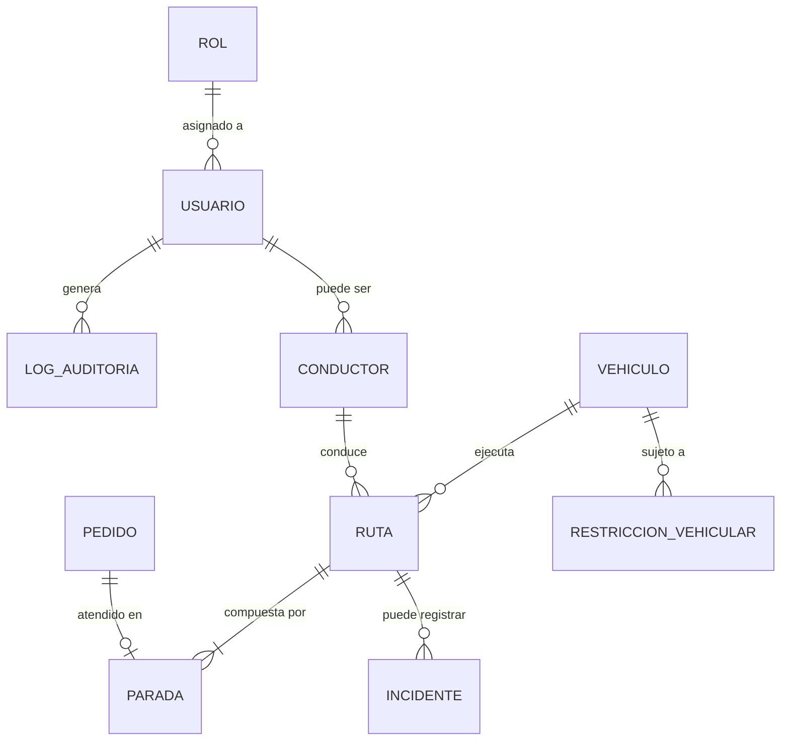

# Diseño e Ingeniería de Base de Datos

> **Decisión vigente V1.1.0:** el MVP utiliza SQLite mediante SQLAlchemy. El archivo persistente es `src/backend/app.db`; no se requiere PostgreSQL ni PostGIS. Las coordenadas se almacenan como valores numéricos y los cálculos geográficos se realizan en la capa de aplicación. Las instrucciones SQL siguientes se mantienen como diseño de referencia, pero PostgreSQL/PostGIS no forma parte de la implementación vigente.

| Campo | Detalle |
| --- | --- |
| **Proyecto** | EcoLogística Lima – Optimizador de Rutas Sostenibles |
| **Integrantes** | Josue [Apellidos] · [Nombre integrante 2] · [Nombre integrante 3] |
| **Fecha** | 25 de agosto de 2026 |
| **Versión** | 1.0.0 |

---

## 1. Modelo Conceptual (Diagrama Entidad-Relación)



## 2. Modelo Lógico

| Entidad | Atributos principales | Clave Primaria (PK) | Claves Foráneas (FK) |
| --- | --- | --- | --- |
| **rol** | nombre, descripcion | rol_id | — |
| **usuario** | nombre, email, password_hash, estado, creado_en | usuario_id | rol_id → rol |
| **conductor** | usuario_id, licencia_numero, licencia_vencimiento, jornada_max_horas | conductor_id | usuario_id → usuario |
| **vehiculo** | placa, capacidad_carga_kg, tipo_combustible, factor_emision_co2, estado | vehiculo_id | — |
| **pedido** | direccion, punto_referencia, ventana_inicio, ventana_fin, estado, cliente_nombre, cliente_telefono | pedido_id | — |
| **ruta** | fecha, vehiculo_id, conductor_id, estado, distancia_total_km, costo_estimado, co2_estimado_kg | ruta_id | vehiculo_id → vehiculo, conductor_id → conductor |
| **parada** | ruta_id, pedido_id, orden, hora_estimada_llegada, hora_real_llegada | parada_id | ruta_id → ruta, pedido_id → pedido |
| **incidente** | ruta_id, tipo, descripcion, registrado_por, fecha_registro | incidente_id | ruta_id → ruta, registrado_por → usuario |
| **restriccion_vehicular** | ultimo_digito_placa, dia_semana, hora_inicio, hora_fin | restriccion_id | — |
| **log_auditoria** | usuario_id, accion, modulo, fecha_hora, resultado | log_id | usuario_id → usuario |

**Nivel de normalización:** el modelo se encuentra en **Tercera Forma Normal (3FN)**: todos los atributos no clave dependen exclusivamente de la clave primaria de su entidad (no existen dependencias transitivas), y los datos repetitivos (como el catálogo de restricciones vehiculares por placa) se modelan en una tabla independiente en lugar de duplicarse en `vehiculo`.

## 3. Modelo físico SQLite vigente

La implementación vigente crea automáticamente las tablas con SQLAlchemy. Coordenadas, distancias y datos relacionados se representan con tipos SQLite estándar (`INTEGER`, `REAL`, `TEXT`, `DATETIME`); no se usa `GEOGRAPHY`, PostGIS ni índices GIST.

```sql
CREATE TABLE vehiculo (vehiculo_id INTEGER PRIMARY KEY AUTOINCREMENT, placa TEXT NOT NULL UNIQUE, capacidad_carga_kg REAL NOT NULL, tipo_combustible TEXT NOT NULL, factor_emision_co2 REAL NOT NULL, estado TEXT NOT NULL DEFAULT 'ACTIVO');
CREATE TABLE pedido (pedido_id INTEGER PRIMARY KEY AUTOINCREMENT, direccion TEXT NOT NULL, latitude REAL NOT NULL, longitude REAL NOT NULL, ventana_inicio TEXT, ventana_fin TEXT, estado TEXT NOT NULL DEFAULT 'PENDIENTE');
CREATE TABLE ruta (ruta_id INTEGER PRIMARY KEY AUTOINCREMENT, fecha TEXT NOT NULL, vehiculo_id INTEGER REFERENCES vehiculo(vehiculo_id), estado TEXT NOT NULL, distancia_total_km REAL, costo_estimado REAL, co2_estimado_kg REAL);
```
