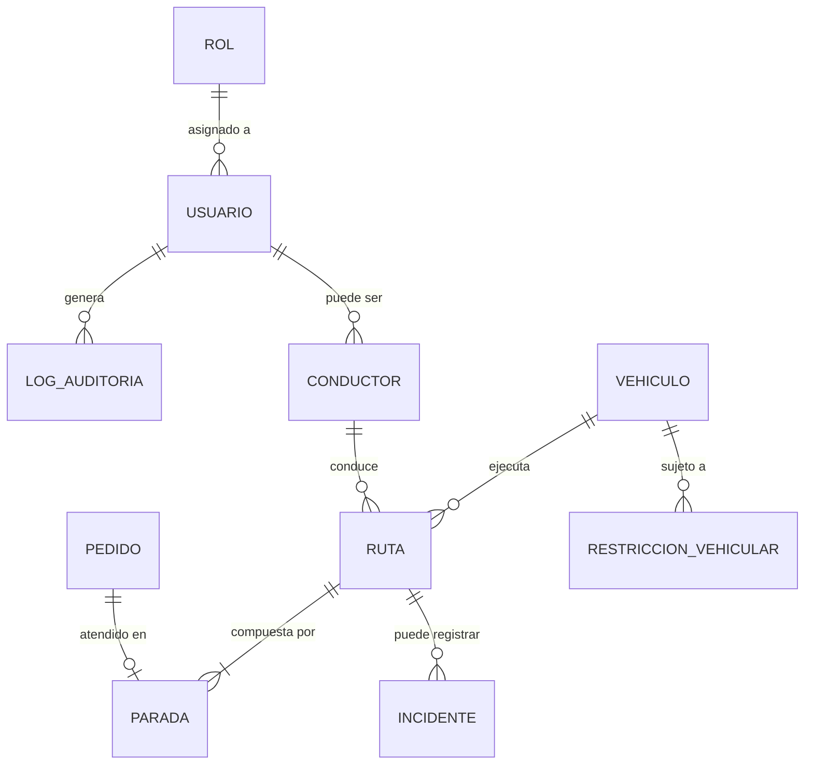

# Diseño e Ingeniería de Base de Datos

> **Decisión vigente V1.2.0:** el MVP utiliza SQLite mediante SQLAlchemy. El archivo persistente es `src/backend/app.db`; no se requiere PostgreSQL ni PostGIS. Las coordenadas se almacenan como valores numéricos y los cálculos geográficos se realizan en la capa de aplicación. Las instrucciones SQL siguientes se mantienen como diseño de referencia, pero PostgreSQL/PostGIS no forma parte de la implementación vigente.

| Campo | Detalle |
| --- | --- |
| **Proyecto** | EcoLogística Lima – Optimizador de Rutas Sostenibles |
| **Integrantes** | Josue [Apellidos] · [Nombre integrante 2] · [Nombre integrante 3] |
| **Fecha** | 25 de agosto de 2026 |
| **Versión** | 1.2.0 |

---

## 1. Modelo Conceptual (Diagrama Entidad-Relación)



## 2. Modelo Lógico

| Entidad | Atributos principales | Clave Primaria (PK) | Claves Foráneas (FK) |
| --- | --- | --- | --- |
| **rol** | nombre, descripcion | rol_id | — |
| **usuario** | nombre, email, password_hash, estado, creado_en | usuario_id | rol_id → rol |
| **conductor** | usuario_id, licencia_numero, licencia_vencimiento, jornada_max_horas | conductor_id | usuario_id → usuario |
| **vehiculo** | placa, capacidad_carga_kg, tipo_combustible, factor_emision_co2, estado | vehiculo_id | — |
| **pedido** | direccion, punto_referencia, ventana_inicio, ventana_fin, estado, cliente_nombre, cliente_telefono | pedido_id | — |
| **ruta** | fecha, vehiculo_id, conductor_id, estado, distancia_total_km, costo_estimado, co2_estimado_kg | ruta_id | vehiculo_id → vehiculo, conductor_id → conductor |
| **parada** | ruta_id, pedido_id, orden, hora_estimada_llegada, hora_real_llegada | parada_id | ruta_id → ruta, pedido_id → pedido |
| **incidente** | ruta_id, tipo, descripcion, registrado_por, fecha_registro | incidente_id | ruta_id → ruta, registrado_por → usuario |
| **restriccion_vehicular** | ultimo_digito_placa, dia_semana, hora_inicio, hora_fin | restriccion_id | — |
| **log_auditoria** | usuario_id, accion, modulo, fecha_hora, resultado | log_id | usuario_id → usuario |

**Nivel de normalización:** el modelo se encuentra en **Tercera Forma Normal (3FN)**: todos los atributos no clave dependen exclusivamente de la clave primaria de su entidad (no existen dependencias transitivas), y los datos repetitivos (como un catálogo futuro de restricciones vehiculares por placa) deben modelarse en una tabla independiente en lugar de duplicarse en `vehiculo`.

## 3. Modelo físico SQLite vigente

La implementación vigente crea automáticamente las tablas con SQLAlchemy. Coordenadas, distancias y datos relacionados se representan con tipos SQLite estándar (`INTEGER`, `REAL`, `TEXT`, `TIME`, `DATETIME`); no se usa `GEOGRAPHY`, PostGIS ni índices GIST. La tabla `customers` incluye las ventanas de entrega opcionales `window_start` y `window_end` (`TIME`) y el campo `demand_kg` (`FLOAT`); al arrancar, `init_db()` agrega las columnas faltantes a una base SQLite existente.

```sql
CREATE TABLE customers (
    id INTEGER PRIMARY KEY,
    name VARCHAR(200) NOT NULL,
    address VARCHAR(255) NOT NULL,
    latitude FLOAT,
    longitude FLOAT,
    priority INTEGER,
    demand_kg FLOAT NULL,
    window_start TIME NULL,
    window_end TIME NULL
);
```

Las horas se envían en formato `HH:MM`. Deben informarse ambas o ninguna y la hora final debe ser posterior a la inicial. OR-Tools las usa como ventanas de llegada, junto con un tiempo estimado de viaje de 25 km/h y 10 minutos de servicio por parada. No se persisten rutas optimizadas ni horas estimadas de llegada por parada.

Los pedidos nuevos deben indicar una demanda positiva en kg. La columna admite `NULL` únicamente para conservar los registros creados antes de incorporar este dato; esos pedidos deben completar su peso antes de asignarse. La optimización compara el peso de las paradas con la capacidad de cada vehículo activo y entrega rutas por vehículo y una lista explícita de pedidos no asignados.

La respuesta del endpoint de optimización incluye `routes` (vehículo, carga, capacidad, paradas y métricas por ruta) y `unassigned` (pedido y motivo). El frontend muestra las paradas de cada ruta sobre mosaicos de OpenStreetMap; el trazado entre puntos es esquemático y no representa calles ni tráfico. Pico y placa no está implementado: no se dispone todavía del horario/fecha de reparto ni del catálogo de jurisdicciones y restricciones por dígito de placa.

Para el alcance implementado y sus límites, ver [Seguimiento de ventanas de entrega y mapa](../03%20Implementacion/Sprint%2003/06%20Avance%20ventanas%20de%20entrega%20y%20mapa%20V_1_0_0.md).

## Historial de versiones

| Versión | Fecha | Cambio |
|---|---|---|
| 1.0.0 | 2026-08-25 | Diseño inicial de base de datos. |
| 1.1.0 | 2026-11-10 | Actualización del modelo físico SQLite con ventanas de entrega, migración automática y coordenadas utilizadas por la vista de mapa. |
| 1.2.0 | 2026-11-10 | Se documenta el peso de pedido, su migración compatible y la salida de rutas con asignación por capacidad y pedidos no asignados. |
